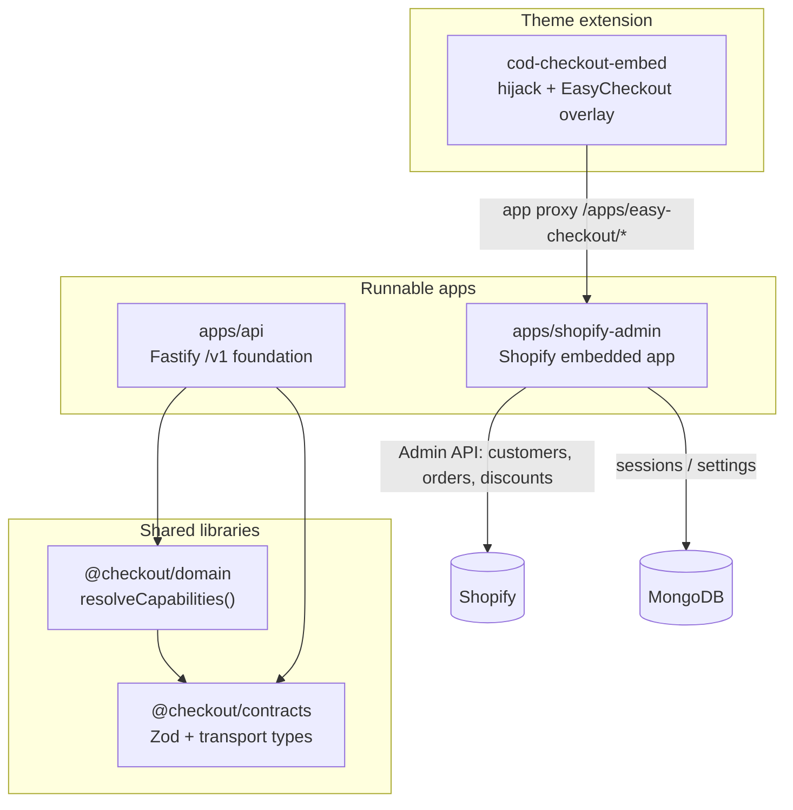
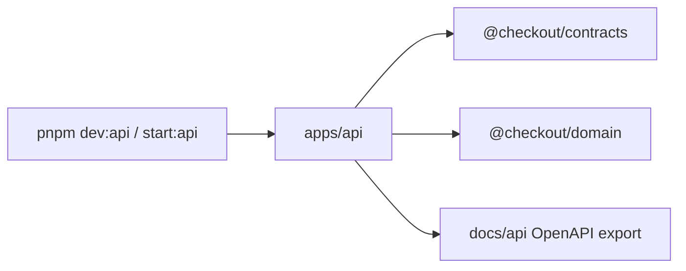
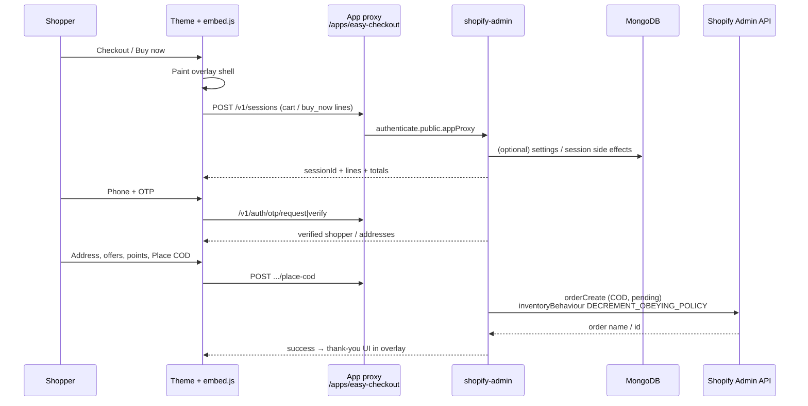

# Checkout platform — system overview

Date: 17 October 2026. Status: living overview of the monorepo parts and how they connect.  
Related: [ADR 0001](0001-platform-foundation.md), [ADR 0002](0002-standalone-cod-checkout.md), [ADR 0003](0003-shopify-installation.md), [ADR 0004](0004-fast-cod-checkout-path.md).

## What this repo is

A **pnpm monorepo** for a merchant COD (cash on delivery) checkout product on Shopify. Shoppers never leave the storefront for the happy path: a theme embed opens an overlay, talks to the Shopify app over **app proxy**, and only creates a Shopify order when they place COD.

There are **four workspace packages** plus **one theme app extension** nested under the admin app.

| #   | Part              | Path                                               | Package name                                  |
| --- | ----------------- | -------------------------------------------------- | --------------------------------------------- |
| 1   | Shared contracts  | `packages/contracts`                               | `@checkout/contracts`                         |
| 2   | Domain policy     | `packages/domain`                                  | `@checkout/domain`                            |
| 3   | Platform API      | `apps/api`                                         | `@checkout/api`                               |
| 4   | Shopify admin app | `apps/shopify-admin`                               | `@checkout/shopify-admin`                     |
| 5   | Storefront embed  | `apps/shopify-admin/extensions/cod-checkout-embed` | (Shopify theme extension, not a pnpm package) |

---

## Visual: monorepo layout

```text
Checkout/                          ← root workspace (checkout-platform)
├── packages/
│   ├── contracts/                 ← Zod schemas, shared types, OpenAPI fragments
│   └── domain/                    ← pure capability / entitlement decisions
├── apps/
│   ├── api/                       ← Fastify foundation API (health, demo, docs)
│   └── shopify-admin/             ← Embedded Shopify app + app-proxy COD backend
│       ├── app/                   ← React Router server routes, Mongo sessions
│       ├── public/checkout/       ← panel.html + checkout.js/css (source of truth)
│       └── extensions/
│           └── cod-checkout-embed ← Theme body embed: hijack + overlay boot
├── docs/                          ← ADRs, runbooks, this overview
└── tests/                         ← unit / integration at repo root
```



**Dependency rule:** libraries never import apps. `domain` depends only on `contracts`. Apps may depend on both. The theme embed talks to the admin app over HTTP (app proxy), not via TypeScript imports.

---

## Part 1 — `@checkout/contracts`

**Role:** Single source of truth for **wire shapes** — money, errors, capabilities, demo checkout sessions, place-COD request/response schemas.

**What it does:**

- Defines strict Zod schemas (`MoneySchema`, `CapabilitiesSchema`, `ErrorResponseSchema`, demo COD types, etc.).
- Exports inferred TypeScript types for consumers.
- Feeds OpenAPI generation for `apps/api` (`contractSchemas`).

**What it does _not_ do:** business decisions, Shopify calls, or persistence.

**Connected to:** imported by `@checkout/domain` and `apps/api`. The live Shopify COD path in `shopify-admin` currently uses its own route handlers/Zod locally; aligning those handlers onto contracts is a future hardening step.

---

## Part 2 — `@checkout/domain`

**Role:** Pure **policy** — given authenticated merchant context, decide which product capabilities are allowed.

**What it does:**

- `resolveCapabilities(merchant, now)` → `{ tier, standaloneCodCheckout, checkoutUiExtension, customPayment }`.
- Denies on inactive install, missing entitlement, expired/mismatched eligibility evidence, etc. (see ADR 0001).

**What it does _not_ do:** HTTP, Mongo, or Shopify. No I/O.

**Connected to:** depends on `@checkout/contracts` types only. Called from the foundation API (and intended for any future gate that must not trust the browser).

---

## Part 3 — `apps/api`

**Role:** Conservative **platform Fastify API** from the foundation ADRs — health, OpenAPI docs, fixture demo COD routes.

**What it does:**

- Process lifecycle (`server.ts`: listen, graceful SIGTERM/SIGINT).
- Health / readiness scoped to “foundation”.
- Demo checkout session + place-COD **fixture** endpoints used for early shell demos (not the live storefront path).
- Rate limits, body size limits, redacted errors (ADR 0001 controls).

**What it does _not_ do today:** serve the merchant storefront overlay or talk to a shop’s Mongo/Shopify install. Live COD runs on the Shopify app proxy.

**Connected to:**



Dev: `pnpm dev:api` · Prod-shaped: `pnpm start:api` after `pnpm build`.

---

## Part 4 — `apps/shopify-admin`

**Role:** The **merchant-facing Shopify app** and the **live COD backend**.

**What it does:**

| Area              | Responsibility                                                                   |
| ----------------- | -------------------------------------------------------------------------------- |
| Embedded admin UI | React Router app inside Shopify Admin (brand settings, enable embed, etc.)       |
| OAuth / sessions  | Shopify app session storage in Mongo (`shopifySessions`), encrypted              |
| App proxy         | Routes under `/proxy/*` exposed to the shop as `/apps/easy-checkout/*`           |
| Checkout APIs     | OTP auth, customer lookup, checkout sessions, quote, offers, settings, place-COD |
| Shopify Admin API | Create COD/`pending` orders, discounts, customer reads/writes                    |
| Asset proxy       | Serves `public/checkout/{panel.html,checkout.js,checkout.css}` with `no-store`   |

**Data stores:**

- **MongoDB** — app sessions, checkout settings (`MONGODB_URI` + `MONGODB_DATABASE`, typically `checkout_development` on port `27028` in local docs).
- **Redis** — live checkout sessions (started when the block opens), the one-order-per-session lock, and per-IP rate-limit counters (`REDIS_URL`). See `docs/api/internal-reference.md` §3.
- **Shopify** — catalog/cart context comes from the storefront; orders are written on place.

**Connected to:** theme embed (inbound proxy), Mongo, Shopify Admin API, and `public/checkout` assets.

---

## Part 5 — `cod-checkout-embed` (theme extension)

**Role:** Storefront **entry point** — hijack Checkout / Buy now, boot the overlay, load panel + JS/CSS.

**What it does:**

- Theme app extension block (`cod-checkout.liquid`) injects `EasyCheckoutConfig` + `embed.js` / `hijack-core.js`.
- On checkout intent: paint an instant shell, fetch `panel.html`, mount `EasyCheckoutApp`.
- All API calls go to `apiBase` (default `/apps/easy-checkout`) so they hit the admin app’s proxy.

**Asset pipeline (important for UX iteration):**

```text
public/checkout/*     ← edit here (source of truth for panel/JS/CSS)
        │
        ├─► app proxy  /apps/easy-checkout/checkout.js|css|panel.html
        │
extensions/.../assets ← copies / CDN fallback; liquid can point at proxy
```

**Visual layers on the storefront:**

```text
┌──────────────────── browser viewport ────────────────────┐
│  Merchant theme (product / cart)                         │
│  ┌──────────────── ec-root (dim scrim) ────────────────┐ │
│  │                    ┌─ ec-shell ─┐  ← docked bottom  │ │
│  │                    │  header     │                  │ │
│  │                    │  summary    │                  │ │
│  │                    │  body       │  login → address │ │
│  │                    │  …          │  → offers → pay  │ │
│  │                    │  sheets     │  full-width      │ │
│  │                    └─────────────┘                  │ │
│  └─────────────────────────────────────────────────────┘ │
└──────────────────────────────────────────────────────────┘
```

---

## End-to-end: how a COD order flows



**Inventory note:** stock is **not** reserved when the overlay opens. Decrement happens on **place** (session-first design, ADR 0004).

---

## How the parts interconnect (summary)

```mermaid
flowchart TB
  subgraph storefront ["Merchant storefront"]
    T[Theme]
    E[cod-checkout-embed]
    T --- E
  end

  subgraph shopify_cloud ["Shopify"]
    AP[App proxy]
    ADMAPI[Admin API]
    ADMINUI[Shopify Admin iframe]
  end

  subgraph our_cloud ["This repo at runtime"]
    SA[shopify-admin process]
    API[apps/api process<br/>optional / foundation]
    MONGO[(MongoDB)]
  end

  subgraph libs ["Compile-time only"]
    CON[@checkout/contracts]
    DOM[@checkout/domain]
  end

  E -->|/apps/easy-checkout/*| AP
  AP --> SA
  ADMINUI -->|embedded app| SA
  SA --> MONGO
  SA --> ADMAPI
  API --> CON
  API --> DOM
  DOM --> CON
```

| From → To                         | Kind of connection                                  |
| --------------------------------- | --------------------------------------------------- |
| embed → shopify-admin             | Runtime HTTP via Shopify app proxy                  |
| shopify-admin → Mongo             | Runtime persistence (sessions, settings)            |
| shopify-admin → Shopify Admin API | Runtime GraphQL/REST with offline token             |
| api → contracts / domain          | Compile-time `workspace:*` imports                  |
| domain → contracts                | Compile-time `workspace:*` imports                  |
| shopify-admin ↔ contracts/domain  | Not wired for live COD yet; admin is self-contained |

---

## Local development map

| Command                    | What runs                                                              |
| -------------------------- | ---------------------------------------------------------------------- |
| `pnpm dev` / `npm run dev` | Shopify CLI → `apps/shopify-admin` + theme extension on the host theme |
| `pnpm dev:api`             | Foundation Fastify API only                                            |
| `pnpm test`                | Repo unit tests (contracts/domain/api-oriented)                        |
| `pnpm test:admin:db`       | Mongo integration tests against `MONGODB_TEST_URI`                     |

Typical COD loop: Mongo up → `pnpm dev` → enable COD Checkout embed in the host theme → open storefront → Checkout.

---

## Where to read next

| Topic                           | Doc                                                                      |
| ------------------------------- | ------------------------------------------------------------------------ |
| Foundation boundaries & threats | [0001-platform-foundation.md](0001-platform-foundation.md)               |
| Standalone COD product choice   | [0002-standalone-cod-checkout.md](0002-standalone-cod-checkout.md)       |
| Install / OAuth                 | [0003-shopify-installation.md](0003-shopify-installation.md)             |
| Session-first speed path        | [0004-fast-cod-checkout-path.md](0004-fast-cod-checkout-path.md)         |
| Scopes                          | [shopify-operation-scopes.md](shopify-operation-scopes.md)               |
| API surface notes               | [../api/README.md](../api/README.md)                                     |
| Shopify local runbook           | [../runbooks/shopify-development.md](../runbooks/shopify-development.md) |
